<h1 align="center"><br>Go-Time-Recording</h1>

<p align="center">
  <b>Project time tracking in a single self-contained binary.</b><br>
  A web interface, a REST API and a terminal client for recording where working
  hours go — self-hosted, on SQLite, PostgreSQL or MySQL.
</p>

<p align="center">
  <a href="https://github.com/dennis-dko/go-time-recording/actions/workflows/ci.yml"></a>
  <a href="https://github.com/dennis-dko/go-time-recording/releases/latest"></a>
  <a href="go.mod"></a>
  <a href="LICENSE"></a>
</p>

<p align="center">
  <a href="#get-started">Get started</a> ·
  <a href="#a-tour">A tour</a> ·
  <a href="#from-a-terminal">From a terminal</a> ·
  <a href="#how-it-fits-together">How it fits together</a> ·
  <a href="#what-it-does">What it does</a> ·
  <a href="#documentation">Documentation</a>
</p>

<picture>
  <source media="(prefers-color-scheme: dark)" srcset="doc/images/calendar-dark.png">
  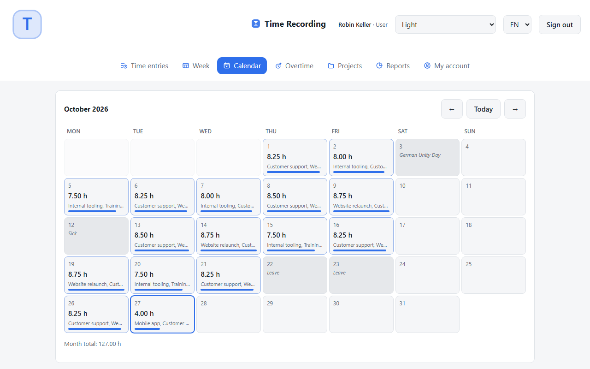
</picture>

## Why Go-Time-Recording

- 📦 **One file to run.** The interface, the API, the terminal client, the schema
  migrations and the timezone database are compiled into one binary — for Linux,
  Windows and macOS, and as an image for amd64 and arm64. Nothing to unpack beside
  it.
- 🔒 **Your hours stay yours.** Every project belongs to one person, and nobody
  else — the administrator included — can read, total or correct anybody's time.
  An installation may switch on managers for the people an administrator assigns
  them, and then those people are told who, and see their name on every entry a
  manager touched. No team totals, no approval queue.
- 🗄️ **The database you already run.** SQLite in a single file, or PostgreSQL or
  MySQL. Started without one, the binary serves an installer on its own port and
  waits.
- 🔑 **Signing in the way your organisation does.** Passwords with an
  authenticator app, passkeys, LDAP and Active Directory with Kerberos single
  sign-on, and OpenID Connect providers such as Keycloak, Authentik, Entra ID or
  Google.
- 📈 **Built to be operated.** Health endpoints, Prometheus metrics,
  OpenTelemetry traces, a live log, a maintenance mode, updates from the settings
  screen and HTTPS with Let's Encrypt.
- 🌍 **For the people using it.** English and German, light and dark, from a
  telephone to a wide screen — and installable as an app.

## A tour

Every picture below is taken from the running application by
[a test](test/browser/readmepictures_test.go) that books a year of somebody's
working time first — `task readme:pictures` takes them again.

<table>
  <tr>
    <td width="50%" valign="top">
      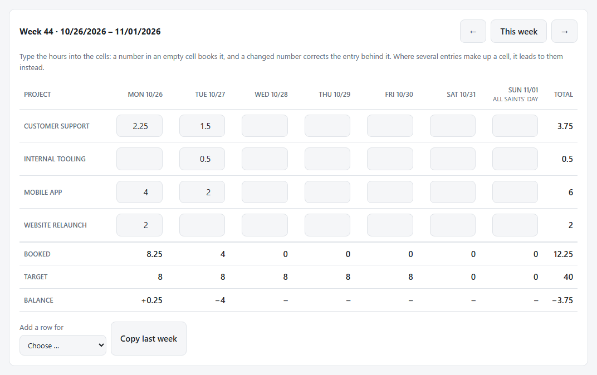
      <p><b>The week as a grid.</b> Type hours straight into the cells; what each day asked and the balance sit underneath, and <i>Copy last week</i> fills the days that are still empty.</p>
    </td>
    <td width="50%" valign="top">
      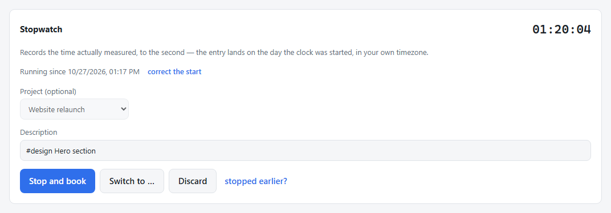
      <p><b>A stopwatch that counts seconds.</b> Switch to the next project without losing one; a start pressed late can be corrected, and a clock left running is booked up to when the work ended.</p>
    </td>
  </tr>
  <tr>
    <td valign="top">
      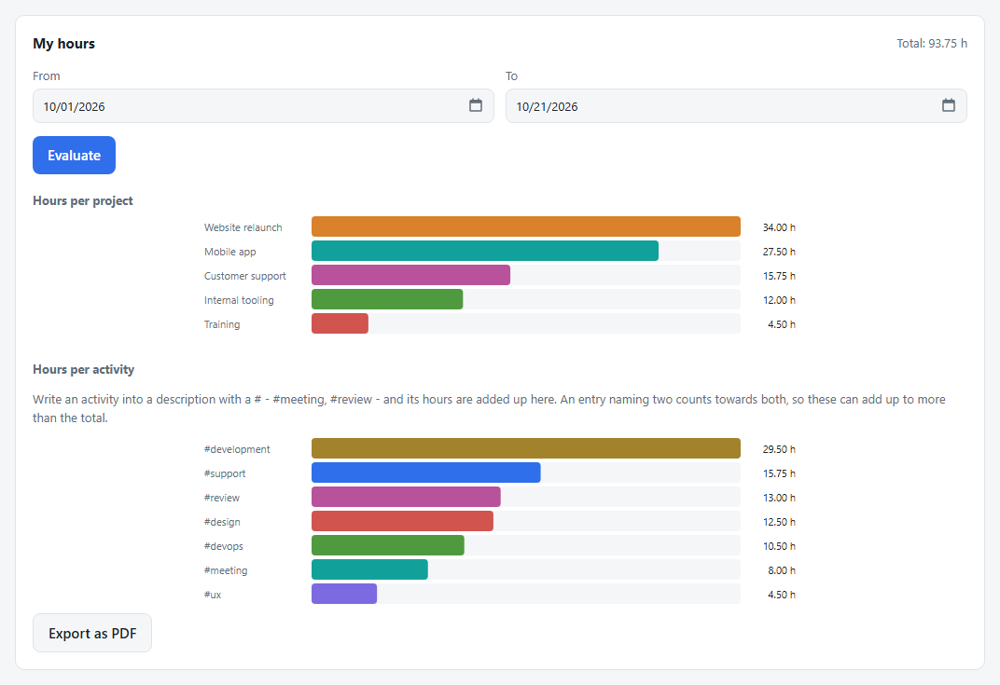
      <p><b>Your own figures, as charts.</b> Hours per project, and per activity: write <code>#meeting</code> or <code>#review</code> into a description and it is counted — nothing to set up first.</p>
    </td>
    <td valign="top">
      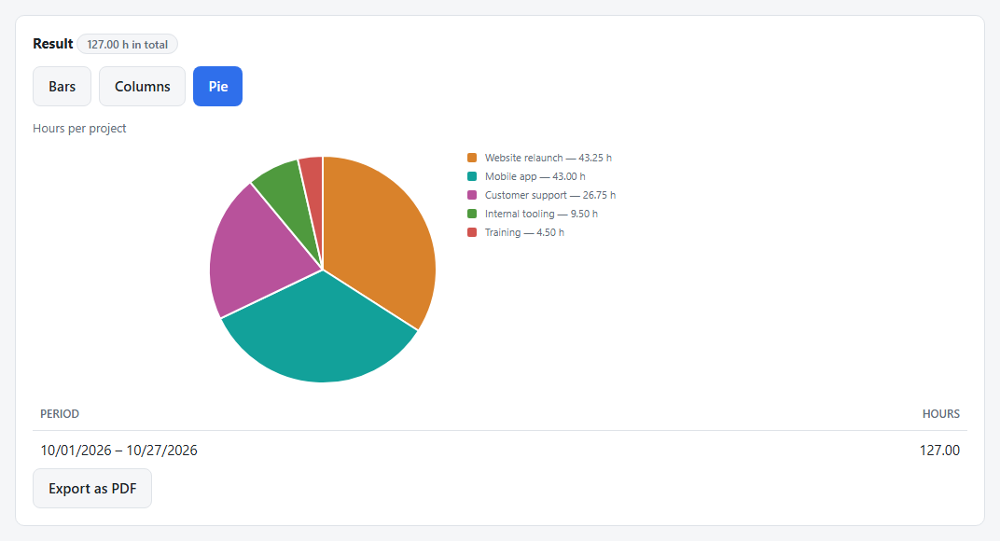
      <p><b>Reports in the shape the question needs.</b> Bars, columns or a pie, each project keeping its colour in all three, and a PDF of the same.</p>
    </td>
  </tr>
  <tr>
    <td valign="top">
      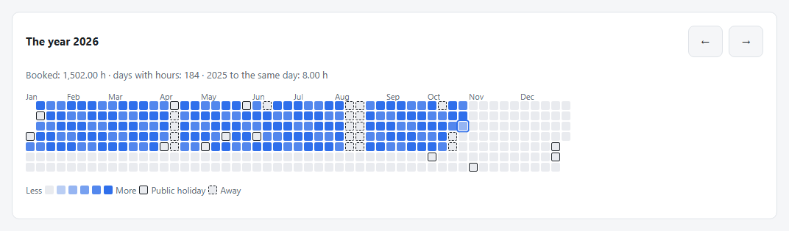
      <p><b>The year at a glance.</b> A tile a day, as dark as the hours on it; public holidays and days away outlined rather than told by colour alone, beside the year before.</p>
    </td>
    <td valign="top">
      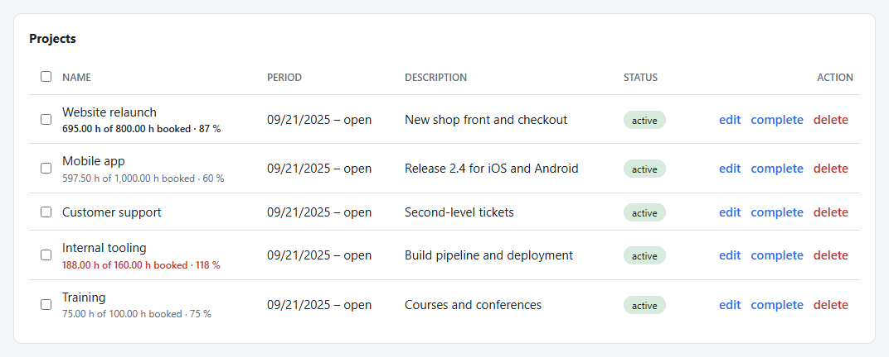
      <p><b>Projects with budgets and rates.</b> The list says how much of a budget is booked, marked from four fifths and in red once it is past, and what a project is charged an hour.</p>
    </td>
  </tr>
  <tr>
    <td colspan="2" valign="top">
      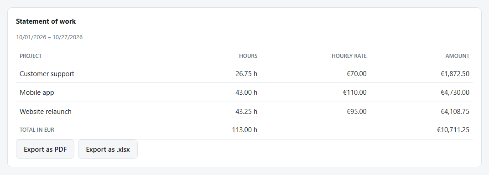
      <p><b>A statement of work at the end of the month.</b> The hours of the projects you charge for, at their rate, totalled per currency, as a PDF or a workbook. Not an invoice: the number, the tax and the customer stay yours to write.</p>
    </td>
  </tr>
  <tr>
    <td valign="top">
      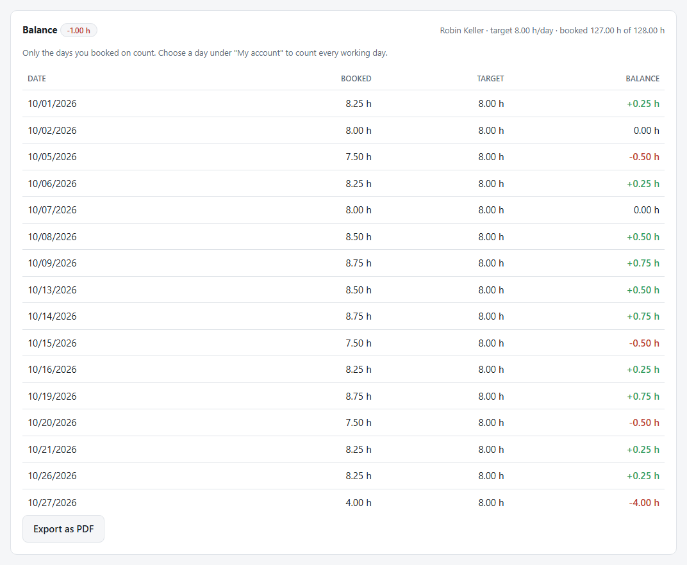
      <p><b>An overtime balance against your own target.</b> Choose a day, and from then on every working day counts — less what a public holiday or a day away takes off it.</p>
    </td>
    <td valign="top">
      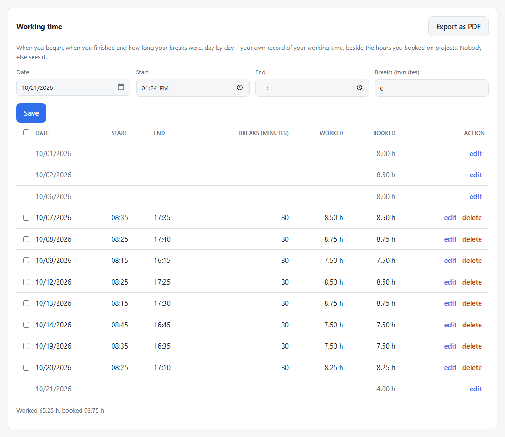
      <p><b>Your working time, on record.</b> When each day began and ended and how long the breaks were, beside the hours booked; a gap shows as one, and the month leaves as a PDF.</p>
    </td>
  </tr>
  <tr>
    <td valign="top">
      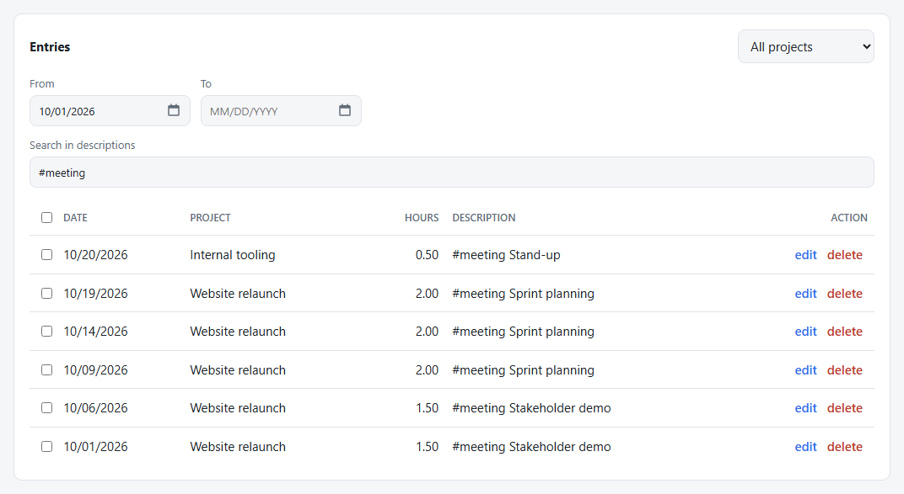
      <p><b>Every entry, findable.</b> Narrow the list by project, period or words in the description — the export follows the same filter — and every correction keeps the version it replaced.</p>
    </td>
    <td valign="top">
      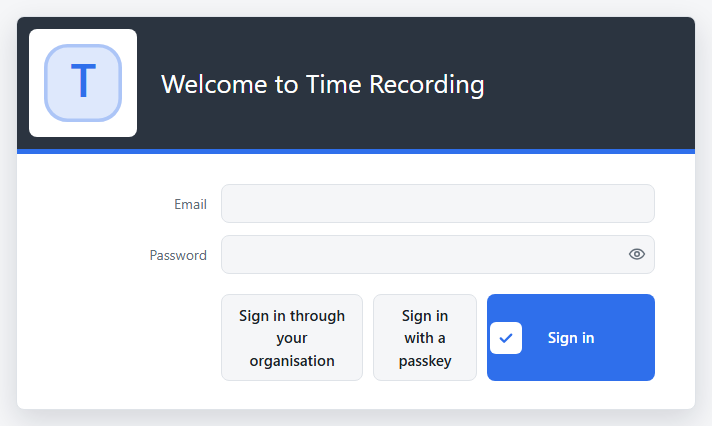
      <p><b>Sign in your way.</b> A password and an authenticator app, a passkey, your organisation's provider — or, inside a domain, the Kerberos ticket the browser already holds.</p>
    </td>
  </tr>
  <tr>
    <td valign="top">
      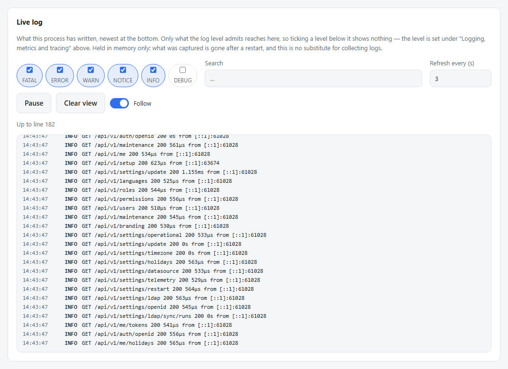
      <p><b>Operated from the browser.</b> The process log, live; the database, the directory, telemetry, maintenance, updates and a restart, all under <i>Settings</i>.</p>
    </td>
    <td valign="top">
      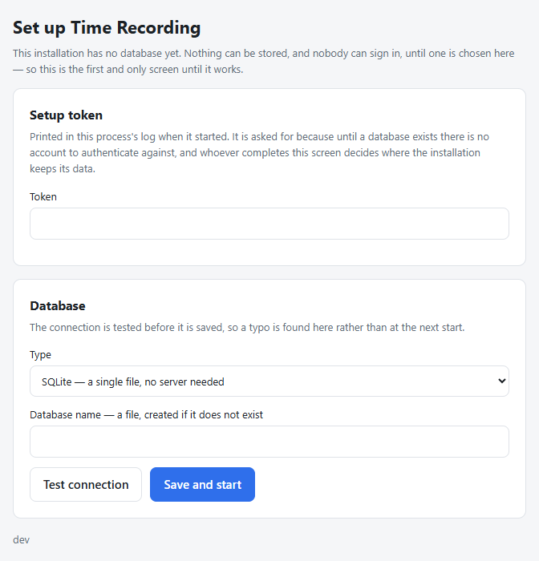
      <p><b>Set up in the browser.</b> Without a database the binary serves this screen, guarded by a token from its log, and then takes its port over in the same process.</p>
    </td>
  </tr>
  <tr>
    <td valign="top">
      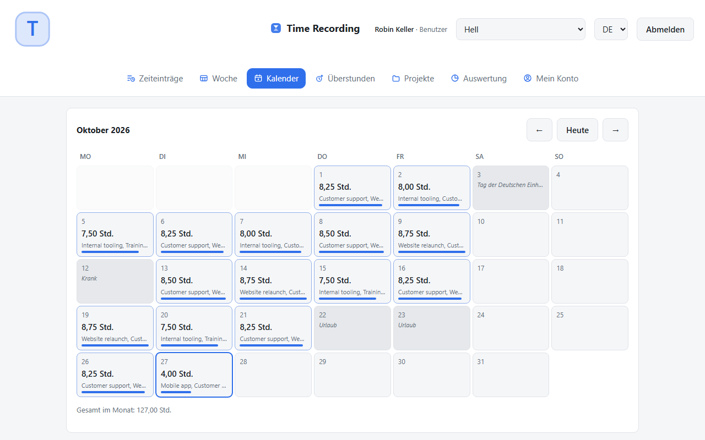
      <p><b>English and German</b>, every screen and every refusal — dates and figures written the way the reader's language writes them.</p>
    </td>
    <td valign="top" align="center">
      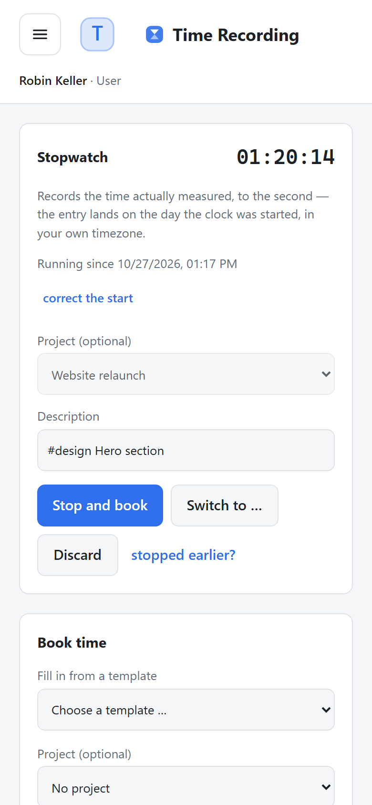
      <p><b>From a telephone to a wide screen</b>, and installable as an app with the installation's own name and logo - which opens without a network, and keeps what is booked meanwhile until it is back.</p>
    </td>
  </tr>
</table>

## How it fits together

One process answers everybody: the browser, the terminal, the scripts, the
calendar apps.

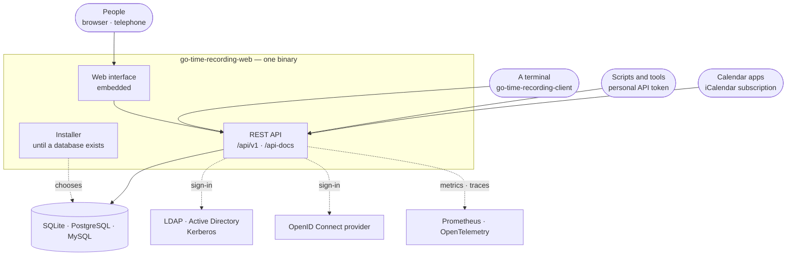

Everything a person books ends up in one place, and every figure is read from
there:

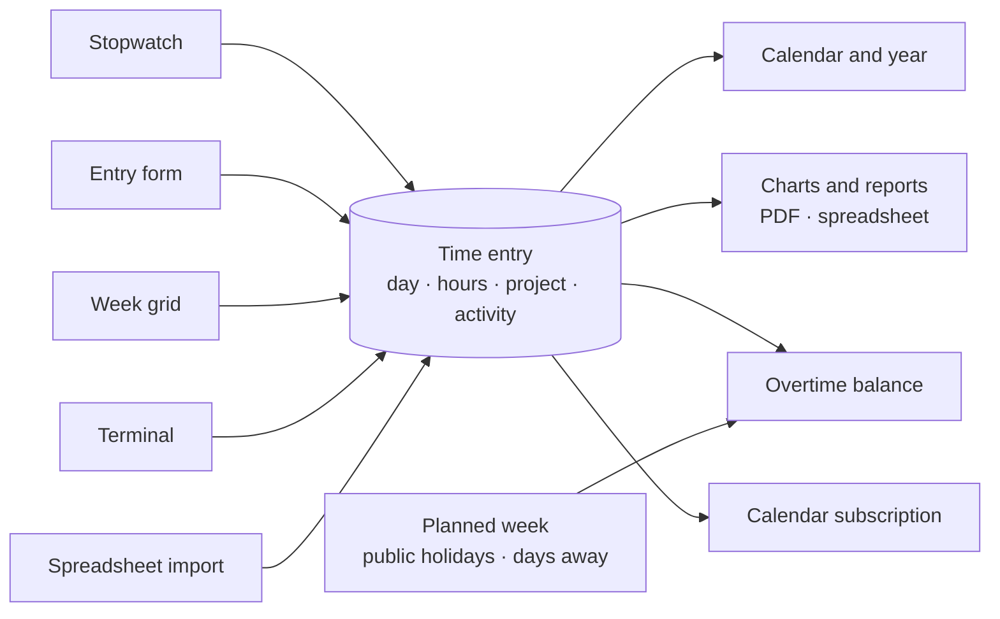

The first start, when nothing is configured yet:

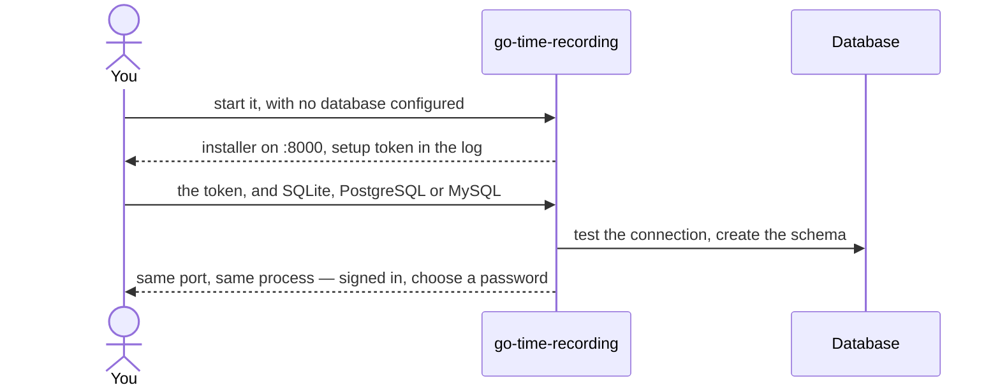

## Get started

**With Docker Compose** — the application and a PostgreSQL beside it, from the
[`deploy/`](deploy/) folder:

```bash
cp .env.example .env    # DB_PASSWORD is required
docker compose up -d
```

**As a single binary** — download `go-time-recording-web` for your platform
from the [latest release](https://github.com/dennis-dko/go-time-recording/releases/latest)
and start it. It is the whole installation; `go-time-recording-client` beside it
is the [terminal client](#from-a-terminal), which only books against one.

```bash
chmod +x go-time-recording-web_*_linux_amd64
./go-time-recording-web_*_linux_amd64
```

Then open <http://localhost:8000>. Without a database the binary serves the
installer, which asks for the setup token printed in its log; with one, sign in
as `admin@local` with the initial password `changeme123`, and the first thing
asked for is a new one. Windows warns about an unknown publisher the first time
— [here is why](doc/getting-started.md#windows-says-unknown-publisher).

**From the source**, with [Task](https://taskfile.dev):

```bash
task dev DB=sqlite      # or: go run ./cmd
```

Running it for real — behind a proxy, with HTTPS, as a service — is
[`deploy/OPERATIONS.md`](deploy/OPERATIONS.md).

## From a terminal

The terminal client, `go-time-recording-client`, books through an
installation's API as the owner of a personal token, and serves nothing itself.
On its own it opens a screen; with a command after it, it does that one thing
and says what it did — for a script, an alias or a screen reader.

<table>
  <tr>
    <td width="50%" valign="top">
      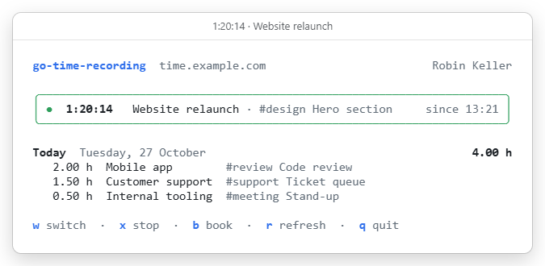
      <p><b>The day at a glance.</b> The stopwatch counts the seconds, and the screen reads the day again every half minute, so a stopwatch stopped in the browser stops here too.</p>
    </td>
    <td width="50%" valign="top">
      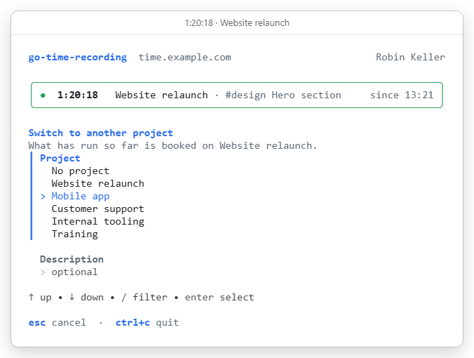
      <p><b>A form for each change.</b> <code>s</code> starts the stopwatch, <code>w</code> switches it to another project and books what has run, <code>x</code> stops it and books it after asking, <code>b</code> books hours by hand; <code>esc</code> puts a form away and <code>q</code> closes the screen.</p>
    </td>
  </tr>
</table>

**It depends on the version of the installation.** The client is built from
the same source as `go-time-recording-web`, the installation's binary, and
released beside it with the same version. What it knows of the installation's
API — the routes, the fields, the codes a refusal carries and the words the page
has for them — is what that version has, so a client from another release may
ask for something the installation does not have, or not understand what it
answers. Use the client whose version is the installation's: the installation
shows its version at the foot of every page, and
`go-time-recording-client --version` says the client's. When the installation
is updated, take the client of the new release as well.

**Set it up once:**

1. Download the terminal client for your platform from the
   [release](https://github.com/dennis-dko/go-time-recording/releases) the
   installation runs — `go-time-recording-client_<version>_<os>_<arch>` — and
   put it on your `PATH` as `go-time-recording-client`, made executable with
   `chmod +x` on Linux and macOS, or as `go-time-recording-client.exe` on
   Windows.
2. In the browser, under **My account → API tokens**, create a token and copy it:
   it is shown once. It carries exactly the rights of your role, can be given a
   number of days to last, and is revoked in the same list.
3. Tell the client where the installation is and who you are — in the
   environment rather than as an argument, where a token would land in the
   shell's history:

   ```bash
   export GTR_URL=https://time.example.com
   export GTR_TOKEN=gtr_...
   ```

   On Windows, once for your account; every terminal opened afterwards has them:

   ```powershell
   [Environment]::SetEnvironmentVariable('GTR_URL', 'https://time.example.com', 'User')
   [Environment]::SetEnvironmentVariable('GTR_TOKEN', 'gtr_...', 'User')
   ```

   The client checks the installation's certificate against the authorities the
   operating system trusts, so one whose certificate comes from an authority of
   its own needs that authority installed on the machine as well.

**Then** `go-time-recording-client` opens the screen, and each change is a
command as well:

```bash
go-time-recording-client status                 # the stopwatch, and today's total
go-time-recording-client start Website -m "landing page"
go-time-recording-client switch Mobile          # books what has run, carries on
go-time-recording-client stop                   # books what it measured
go-time-recording-client book 1:30 Customer -d 2026-10-21
go-time-recording-client today                  # today's entries
```

A project is named as it is called, in any case, or by the start of its name
when no other active project starts the same way; hours are written 1.5, 1,5 or
1:30. `go-time-recording-client help` lists the commands, and
[the API page](doc/api.md#from-a-terminal) says what the client answers, and
with which exit status.

The client speaks English or German: `--lang de` or `--lang en` anywhere on the
line, `GTR_LANG` to keep one, and otherwise the language the account chose in
the browser - or, where it chose none, the language the system is set to. In
German it says what the installation refuses in the words the web interface has
for it.

## What it does

| Area | What you get | Read more |
| --- | --- | --- |
| **Recording** | Stopwatch, entry form and week grid; templates for what is booked often; changes to many entries at once; spreadsheet import and export | [Features](doc/features.md) |
| **History** | Every correction keeps the version it replaced, for the entry's owner | [Features](doc/features.md#business-rules) |
| **Evaluating** | Charts per day, project and activity, reports as bars, columns or a pie, the year as tiles, statements of work, PDF exports | [Features](doc/features.md) |
| **Projects** | Private to their owner, with a period, a status, an hour budget and an hourly rate | [Projects](doc/features.md#projects) |
| **Targets and time off** | A planned week, the public holidays of every German state, leave with its entitlement and carry-over, sick days and days taken against overtime | [Overtime](doc/features.md#overtime) |
| **Working time** | When each day began and ended and its breaks, for each person's own record | [Working time](doc/features.md#your-own-record-of-your-working-time) |
| **Calendar subscription** | Booked days and days away in Outlook, Google or a telephone's calendar | [Calendar](doc/features.md#your-days-in-your-own-calendar) |
| **Accounts and roles** | Roles and their rights administered at run time; an administrator who runs the installation without keeping hours in it; managers for the accounts assigned to them, where an installation switches them on | [Access](doc/access.md) |
| **Sign-in** | Passwords with TOTP, passkeys, LDAP and Active Directory with synchronisation, Kerberos, OpenID Connect | [Sign-in](doc/access.md#ldap) |
| **API** | REST under `/api/v1`, described at `/api-docs`, reached with personal tokens that never outrank their owner - and `go-time-recording-client` books through it from a terminal, on a screen of its own or a command at a time | [API](doc/api.md) |
| **Operations** | Health, metrics, traces, live log, maintenance mode, updates, restart, HTTPS with Let's Encrypt, the installation's own name and logo | [Configuration](doc/configuration.md) |

## Documentation

| Page | What it covers |
| --- | --- |
| [Getting started](doc/getting-started.md) | The installer, the first sign-in, the setup wizard and the tour |
| [Features](doc/features.md) | Everything the application does, and the rules it keeps while doing it |
| [Accounts, roles and sign-in](doc/access.md) | Rights, the administrator, API tokens, LDAP, Kerberos and OpenID Connect |
| [Security](doc/security.md) | Sessions, CSRF, passkeys, two factors, HTTPS, and what a copy of the database gives away |
| [Configuration](doc/configuration.md) | Where each setting comes from, and what the interface can change |
| [API](doc/api.md) | Booking from a terminal, what a refusal looks like, and what the metrics carry |
| [Architecture](doc/architecture.md) | The four layers, and the decisions that would otherwise surprise |
| [Development](doc/development.md) | The environments, and the checks a change has to pass |
| [Releases and deployment](doc/deployment.md) | How a release is made and what it carries |
| [Operations manual](deploy/OPERATIONS.md) | For whoever runs it: the four ways to deploy, backups, restarts, health |

Built on [GoFr](https://gofr.dev), structured after [gogs](https://github.com/gogs/gogs).

## License

[MIT](LICENSE).
